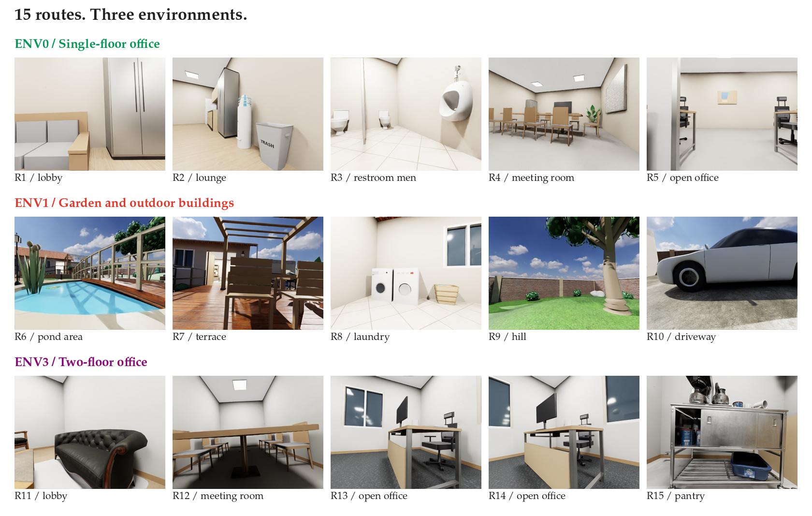
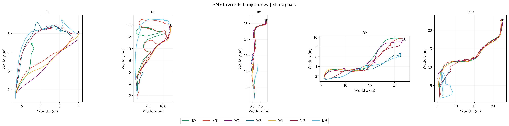
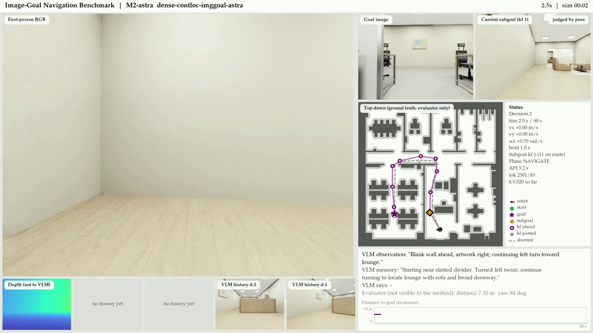
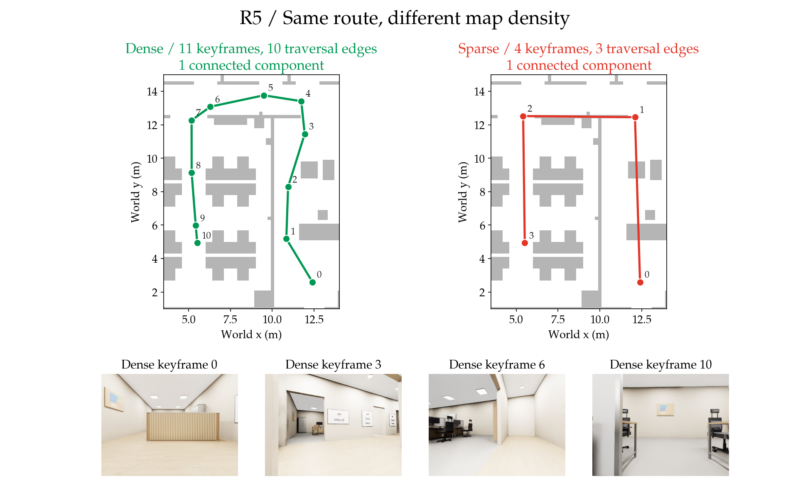

# Visual Navigation Benchmark

Given a goal photograph, can a robot navigate to the same place and face the same
direction? This benchmark compares image-goal navigation with point-goal baselines
on a simulated Unitree Go2: seven methods, three Isaac Sim scenes and 15 routes.

The repository bundles the evaluation code, goal images, route maps, scene assets
and learned models. Start with the CPU check below; running navigation also
requires an NVIDIA GPU host and the simulator setup.

[Quick start](#quick-start-verify-locally) · [Simulation setup](#set-up-simulation) ·
[Run evaluations](#run-evaluations) · [Methods](#methods) · [Data and layout](#data-and-layout)



*The actual evaluation goals: five per scene. R13 and R14 end in the same room
but follow different routes. [Figure sources and reproduction](docs/visuals/README.md).*

## Quick start: verify locally

**Requires:** Linux and Python 3.8 or 3.10. Run all commands from the repository root.

```bash
VNAV_EVAL_PYTHON=python3.10 bash setup/evaluation.sh
source .venv-eval/bin/activate
python scripts/check_install.py --smoke
```

Use `VNAV_EVAL_PYTHON=python3.8` if that is your installed interpreter. The setup
script creates `.venv-eval` and refuses to overwrite an existing environment;
activate an existing installation to repeat the check.

Successful output reports **30 maps, 15 active maps and 15 episodes**, with
`smoke.status` equal to `excluded_debug`. It verifies file checksums, map
fingerprints and scene identities, then runs one temporary CPU debugging cell.
This check requires no GPU or API credentials and makes no model API calls.

<details>
<summary>Alternative: use Conda for evaluation</summary>

```bash
conda env create -f setup/evaluation.yml
conda activate vnav-eval
python -m pip install -e '.[evaluation]'
python scripts/check_install.py --smoke
```

The Conda definition uses Python 3.10. Environment definitions and bounded
requirements are in [setup/](setup/); they describe dependencies rather than
bundling an installed virtual environment.

</details>

## Set up simulation

The steps below use one Linux NVIDIA GPU machine for all three roles:

| Role | Environment | Python | Purpose |
| --- | --- | --- | --- |
| Evaluation | `.venv-eval` or `vnav-eval` | 3.8 / 3.10 | Runs methods, scores episodes and builds reports |
| Simulation | `vnav-sim` | 3.11 | Runs Isaac Sim 5.1 and the Go2 |
| Local controller | `vnav-sru` | 3.10 | Runs SRU-Odin on CPU |

Install Conda and the NVIDIA driver required by your Isaac Sim installation, then:

```bash
bash setup/simulation.sh --dry-run
bash setup/simulation.sh
conda run -n vnav-sim python setup/robot.py
conda run -n vnav-sim python setup/robot.py --check
```

The first command previews installation. The second creates two new environments;
it refuses existing names. The robot helper downloads the official Go2 asset,
checks its hashes and constructs the benchmark's 3 kg Odin payload locally.
NVIDIA robot files stay outside public Git under their upstream license. See
[asset preparation](assets/README.md#prepare-the-go2-robot) and NVIDIA's
[Isaac Sim installation instructions](https://docs.isaacsim.omniverse.nvidia.com/5.1.0/installation/install_python.html).

### Configure the interpreters

Create a private configuration file, preserving any existing one:

```bash
cp -n .env.example .env
conda run -n vnav-sim python -c "import sys; print(sys.executable)"
conda run -n vnav-sru python -c "import sys; print(sys.executable)"
```

Edit `.env`: put the first printed path in `VNAV_SIM_PYTHON` and the second in
`VNAV_SRU_PYTHON`. Use absolute paths; the configuration parser does not expand
shell expressions such as `$HOME` or `~`. The evaluation commands below read
`.env` directly.

| Setting | When to set it |
| --- | --- |
| `VNAV_SIM_PYTHON` | Python executable in the simulator environment |
| `VNAV_SRU_PYTHON` | Python executable in the CPU controller environment |
| `OPENAI_API_KEY` | Astra image-goal methods and AM/AMem/AMM |
| `DASHSCOPE_API_KEY` | Qwen image-goal methods |
| `VNAV_DATA_DIR` / `VNAV_ASSET_DIR` | Optional runtime paths; keep the bundled defaults for the checkout verification |

Keep `.env` private. B0 and M1 use local SRU inference and require no VLM API key.
To include the locally installed robot in the installation check, run
`python scripts/check_install.py --robot` from the evaluation environment.

<details>
<summary>Optional: evaluation and simulation on separate machines</summary>

Install the same release on both machines. On the evaluation machine, set
`VNAV_DESKTOP_HOST` to the SSH destination and `VNAV_DESKTOP_REPO` to the absolute
repository path on the simulator machine. Configure SSH access before running.

SRU runs on the **evaluation machine**. Create its environment there:

```bash
conda env create -f setup/sru.yml
conda run -n vnav-sru python -m pip install -e .
```

Set `VNAV_SRU_PYTHON` in the evaluation machine's `.env`. Set `VNAV_SIM_PYTHON`
in the simulator machine's `.env`. Each machine reads its own paths and settings;
`VNAV_DESKTOP_HOST` defaults to `localhost` for a single-machine installation.

</details>

## Run evaluations

Activate the evaluation environment before running these commands.

### First baseline: B0

```bash
python scripts/campaign_run.py --campaign env0_b0 --episodes env0_test_v3 \
  --methods dense-contloc-ptgoal --backend isaac --slot s1
```

This runs five ENV0 routes. Add `--max-jobs 1` to run one new cell at a time.
Repeat the same command to resume; completed cells are preserved. A busy simulator
slot is refused, and shutdown targets the process launched by this campaign.

| Scene | Episode set | Routes | Simulation budget per episode |
| --- | --- | --- | --- |
| ENV0: single-floor office | `env0_test_v3` | R1–R5 | 90 s |
| ENV1: garden and outdoor buildings | `env1_test_v1` | R6–R10 | 90 s |
| ENV3: two-floor office | `env3_test_v1` | R11–R15 | 120 s |

### Image-goal example: M5 with Astra

Set `OPENAI_API_KEY` in `.env`, then run:

```bash
python scripts/campaign_run.py --campaign env0_m5 --episodes env0_test_v3 \
  --methods sparse-initloc-imggoal-astra --backend isaac --slot s1
```

VLM runs incur provider API charges. The budget guard records usage and enforces
spending limits. Choose another method ID from the table below to compare methods.

### Active-map and memory ablations

AM, AMem and AMM use the supplied, fixed keyframe selections. AM and AMM share
the same selected maps; these commands rerun navigation with those maps.

| Variant | Map | Memory |
| --- | --- | --- |
| AM | Active selection | M5 baseline |
| AMem | M5 baseline | Active memory |
| AMM | Active selection | Active memory |

```bash
# Check inputs and plan the Isaac campaign; no simulator or model API calls.
python scripts/ablation_run.py --episodes env1_test_v1 --campaign env1_ablations \
  --variants AM,AMem,AMM --backend isaac --slot s1 --max-jobs 0

# Run navigation after configuring simulation, SRU and OPENAI_API_KEY.
python scripts/ablation_run.py --episodes env1_test_v1 --campaign env1_ablations \
  --variants AM,AMem,AMM --backend isaac --slot s1
```

Each variant has its own output directory and shares a tagged budget ledger.
Keep the same backend, variants and campaign name when resuming. Use
`--max-jobs 0` for preparation only; a kinematic VLM run with a positive job
count still calls the model. Rerunning keyframe selection is a separate experiment
from these fixed-selection ablations.

### Inspect results

Outputs are stored under `data/campaigns/NAME/`, or under `VNAV_DATA_DIR` when set:

```bash
python scripts/coverage_report.py data/campaigns/env0_b0
python scripts/report_build.py data/campaigns/env0_b0
```

Coverage lists completed, pending and blocked cells. Reports are written to the
campaign's `report/` directory, including tables and PNG/PDF figures. Ablation
reports use each variant directory, such as `data/campaigns/env1_ablations/AM`.

For video previews, run
`python -m vnav_benchmark.report.episode_video RUN_DIR --stills`, replacing
`RUN_DIR` with one episode run directory under the campaign's `runs/` tree.

### Example recorded results



*Recorded ENV1 trajectories from the historical v18 documentation snapshot
(2026-10-24); stars mark goals and colors distinguish methods. These are archived
runs, not validation of the current checkout. Position traces alone do not establish
success, which also requires the final heading.*

<details>
<summary>Inspect one recorded M2 step in ENV0</summary>



This archived R5 frame shows the first-person RGB observation, goal photograph,
selected subgoal and recorded decision state. The top-down truth view and
distance-to-goal plot are evaluator diagnostics, hidden from the method.
The frame is an intermediate step, not an episode outcome.

</details>

Both archived images are preserved byte-for-byte. Their source snapshot and
checksums are documented in [visual provenance](docs/visuals/README.md).
Generate fresh results with the campaign and report commands above.

## Methods

SRU-Odin is the learned local point-goal controller. Image-goal methods use a
vision-language model (VLM) to choose navigation actions from RGB images.

| Method | Map | Localization | Method ID (Astra where applicable) |
| --- | --- | --- | --- |
| B0 | Dense | Continuous | `dense-contloc-ptgoal` |
| M1 | Sparse | Continuous | `sparse-contloc-ptgoal` |
| M2 | Dense | Continuous | `dense-contloc-imggoal-astra` |
| M3 | Sparse | Continuous | `sparse-contloc-imggoal-astra` |
| M4 | Dense | Initial only | `dense-initloc-imggoal-astra` |
| M5 | Sparse | Initial only | `sparse-initloc-imggoal-astra` |
| M6 | None | None | `nomap-noloc-imggoal-astra` |

For a Qwen configuration, replace the `-astra` suffix with `-qwen` and configure
`DASHSCOPE_API_KEY`. AM/AMem/AMM retain the M5/Astra method ID and record their
experimental variant separately.



*The bundled R5 maps contain 11 dense keyframes and 4 sparse keyframes. Lines
show traversal graph links, not executed trajectories. The gray floor plan is
evaluator geometry used here for illustration. Each map node has a photograph and
pose; the four photographs below come from the dense map.*

Methods receive RGB-D, relative odometry and permitted map/localization access.
VLM requests contain RGB images only. World poses and truth grids belong to the
evaluator. Strict success requires position within 0.5 m and heading within
45 degrees; loose success uses 2 m and 90 degrees. Scored failures remain in the
results with their consumed simulation time.

## Data and layout

```text
vnav_benchmark/   Navigation methods, map readers, evaluator, simulator and reports
configs/         Benchmark rules, map registry, episode sets and integrity manifests
data/            30 route maps, 15 active maps and evaluator scene metadata
assets/          Scene USDs/textures, model weights, licenses and asset inventory
setup/           Environment definitions, installers and robot preparation
scripts/         Evaluation, ablation, verification and report entrypoints
third_party/     Minimal SRU-Odin inference source
tests/           CPU regression tests and fixtures
docs/visuals/    README figures, reproduction instructions and provenance
```

Goal photographs and depth images are stored with the episode sets under
[`configs/episodes/`](configs/episodes/). Map fingerprints and goal image bytes
retain their original values. Portable map-source bindings and their original
provenance are recorded in [`data/episode_provenance.json`](data/episode_provenance.json).

The [asset guide](assets/README.md) lists the bundled inputs and their licenses.
Source, configuration and asset manifests are checked by `check_install.py`.
Route labels remain R1–R15; map directories use names such as `R01_dense` and
`R01_sparse`, with bindings recorded in `configs/maps.yaml`.

## Contributing

Install the developer dependencies in the evaluation environment and run the
repository checks:

```bash
python -m pip install -e '.[evaluation,dev]'
bash scripts/verify.sh
```

See [CONTRIBUTING.md](CONTRIBUTING.md) for the development workflow and
[SECURITY.md](SECURITY.md) for reporting security issues. Rebuild the dataset
figures with `python scripts/readme_figures.py`; see
[visual provenance](docs/visuals/README.md) for what can be reproduced locally.

## License and citation

Benchmark code and data use [MIT](LICENSE). Retained dependencies and assets
carry their own notices in [NOTICE](NOTICE) and [assets/LICENSES/](assets/LICENSES/).
Use [CITATION.cff](CITATION.cff) to cite the software.
